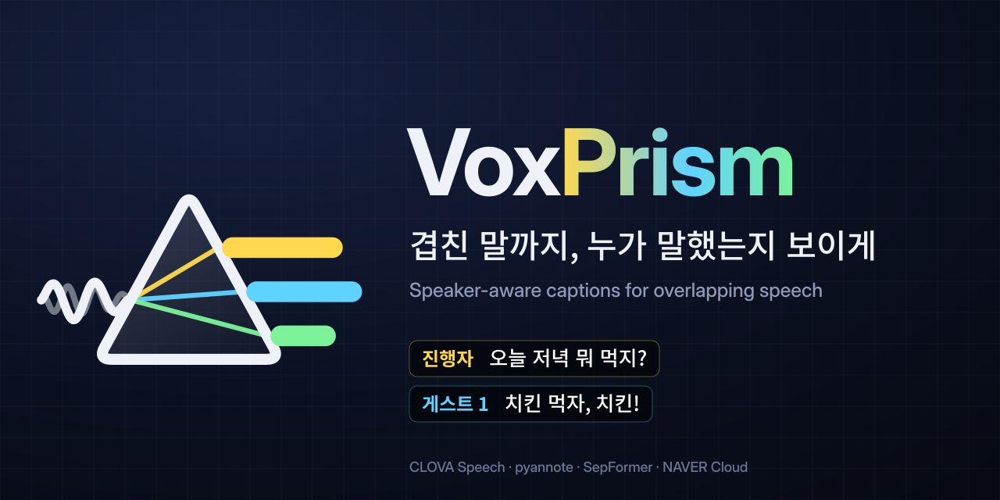
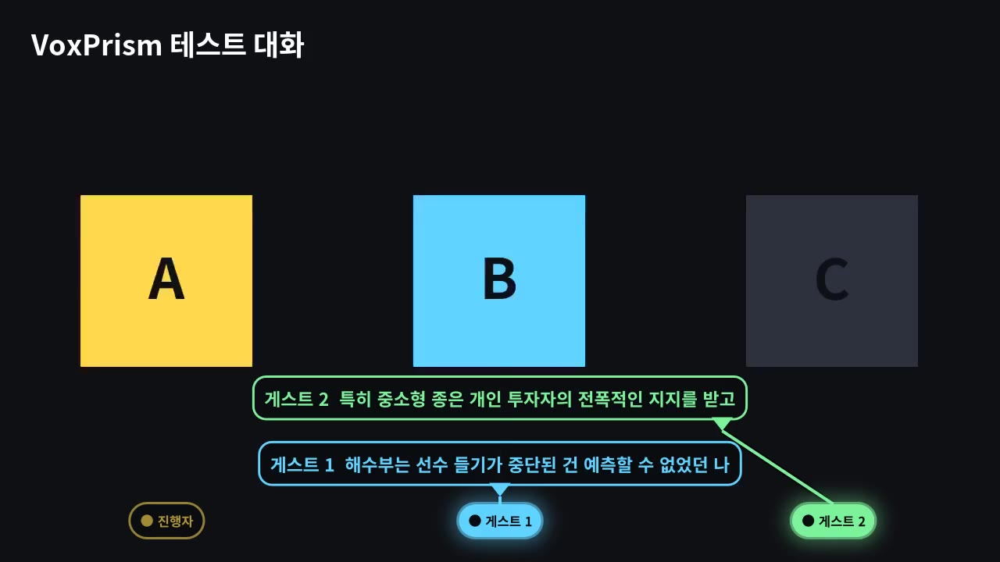
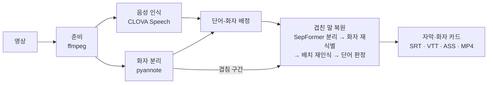

<p align="center">
  
</p>

<p align="center">
  <a href="https://github.com/voxprism/voxprism/actions/workflows/ci.yml"></a>
  
  
  
  
  
  <br>
  <a href="docs/05-SDD-개발-프로세스.md"></a>
  <a href="CONTRIBUTING.md"></a>
  
</p>

**VoxPrism**(복스프리즘)은 영상을 올리면 **말한 사람의 이름과 색이 붙은 자막**을 만들고, 두 사람이 **동시에 말해 묻힌 말까지** 분리해서 함께 보여 주는 서비스입니다. 프리즘이 빛을 색으로 나누듯, 섞인 목소리를 화자별 색으로 나눕니다.

> 유튜브 예능 자막은 누가 말했는지 알려 주지 않고, 여러 명이 동시에 말하면 말이 사라집니다. 자막에 기대어 보는 청각장애인·난청인에게는 그 순간이 가장 재미있는 장면입니다.

## ✨ 기능

| | 기능 | 설명 |
| --- | --- | --- |
| 🎨 | 화자 색 자막 | 화자마다 색과 이름표. 색 없이도 이름표로 구분 |
| 💬 | 고정 줄 말풍선 | 동시에 말해도 자막이 제자리를 지키고, 화면 아래 표시줄에서 말하는 사람 칩이 화자 색으로 켜지며 말풍선 꼬리가 그 사람을 가리킴 |
| 🔀 | 겹친 말 복원 | 겹친 구간을 SepFormer로 나눠 다시 받아 적고, 묻힌 사람의 말을 '복원' 자막으로 추가 |
| 🧑‍🤝‍🧑 | 화자 카드 | 혼자 말하는 장면 3장과 대표 대사를 보고 이름 붙이기·합치기 |
| 📜 | 대본 | 시간순 대본, '동시'·'복원' 표시, 눌러서 그 장면으로 |
| 🔠 | 보기 설정 | 글자 크기 3단계, 위·아래, 이름표·말하는 사람 표시·소리 자막 켜고 끄기, 전체 화면 |
| 📦 | 내보내기 | SRT · WebVTT(화자 색) · ASS(화자 스타일) · JSON · 자막 입힌 MP4 |

<p align="center">
  
  <br><sub>테스트 영상 31.9초 — 일반 자막에서는 사라지던 맞장구가 복원되어 두 줄이 함께 뜬다</sub>
</p>

## 📈 결과

정답이 있는 합성 겹침 대화 3개(겹친 발화 35개), 출연자 수 입력 기준. 원자료: [`docs/eval_v2.json`](docs/eval_v2.json)

| 조건 | 화자별 오류율 cpCER ↓ | 겹친 발화 재현율 ↑ | 사라진 겹친 발화 ↓ |
| --- | --- | --- | --- |
| 일반 자막 (화자 표시 없음) | 1.137 | 0.166 | 28 |
| 화자 구분만 | 0.450 | 0.535 | 10 |
| **VoxPrism (화자 구분 + 겹친 말 복원)** | **0.344** | **0.752** | **3** |

처리 시간은 영상 길이의 약 1.2배입니다(CPU 서버, 복원을 끄면 약 0.6배). 합성 대화는 배경음악이 없어 실제 예능보다 쉬운 조건입니다.

## ⚙️ 동작 방식



한국어 받아쓰기는 국내 클라우드의 국내 모델(네이버 클라우드 CLOVA Speech)이, 화자 분리·음원 분리는 서버 안의 오픈 모델이 맡습니다. 자세한 설계는 [상세설계](docs/02-상세설계.md).

## 🚀 시작하기

```bash
git clone https://github.com/voxprism/voxprism.git && cd voxprism
./scripts/setup-dev.sh                                   # git 훅·커밋 메시지 틀
python3 -m venv .venv && . .venv/bin/activate
pip install -r app/requirements-ci.txt
cd app && python -m pytest -q tests                      # 모델 없이 도는 단위 테스트
WHOSAID_DATA_DIR=/tmp/voxprism python -m uvicorn whosaid.web.main:app --reload
```

모델까지 돌리려면 `app/requirements.txt`(torch CPU, pyannote, SpeechBrain, faster-whisper)와 CLOVA Speech·Hugging Face 키가 필요합니다. 네이버 클라우드 서버 만들기·배포는 [SPEC-006](specs/006-ncp-deploy/spec.md)과 [인수인계](docs/06-인수인계.md)에 있습니다.

## 📚 문서

| 문서 | 내용 |
| --- | --- |
| [PRD](docs/00-PRD.md) | 문제, 사용자, 목표·지표, 범위 |
| [요구사항 분석](docs/01-요구사항-분석.md) | FR/NFR ID, 수용 기준, 추적표 |
| [상세설계](docs/02-상세설계.md) | 구성, 데이터, 겹친 말 알고리즘, API, 보안, 결정 기록 |
| [기능 구현](docs/03-기능-구현.md) | 코드 지도, 로컬 실행, 기술 부채 |
| [디자인](docs/04-디자인.md) | 브랜드, 화자 색·대비, 자막 디자인, 접근성 |
| [SDD 개발 프로세스](docs/05-SDD-개발-프로세스.md) | 스펙 → 설계 → 작업 → 구현, 품질 게이트 |
| [인수인계](docs/06-인수인계.md) | 지금 상태, 서버 운영, 다음 할 일 |
| [specs/](specs/README.md) | 기능별 스펙 8개 |

## 🗂️ 구조

```text
app/whosaid/        서비스 (내부 코드명 whosaid) — pipeline/ · web/ · store · worker
app/deploy/         서버 설치 스크립트, nginx, systemd
app/tools/          평가: 겹침 대화 생성, 지표 계산
app/tests/          단위 테스트
infra/              네이버 클라우드 CLI 스크립트 (생성·배포·정지·시작)
specs/              SDD 스펙 (spec · plan · tasks)
docs/               PRD · 요구사항 · 설계 · 구현 · 디자인 · 프로세스 · 인수인계
scripts/            스펙 검사, 커밋 규칙 검사, 비밀 검사, 라벨 동기화
assets/brand/       로고·배너·아이콘
```

## 🤝 기여

[CONTRIBUTING.md](CONTRIBUTING.md)의 브랜치·커밋·PR 규칙과 [SDD 프로세스](docs/05-SDD-개발-프로세스.md)를 따릅니다. 새 기능은 이슈 → 스펙 → 승인 → 구현 순서입니다. AI 에이전트 규칙은 [AGENTS.md](AGENTS.md).

## 🙏 사용한 것

[CLOVA Speech](https://www.ncloud.com/product/aiService/clovaSpeech) · [pyannote.audio](https://github.com/pyannote/pyannote-audio) · [SpeechBrain SepFormer (WHAMR!)](https://huggingface.co/speechbrain/sepformer-whamr16k) · [WeSpeaker ResNet34](https://huggingface.co/pyannote/wespeaker-voxceleb-resnet34-LM) · [faster-whisper](https://github.com/SYSTRAN/faster-whisper) · 평가 데이터 [Zeroth-Korean](https://huggingface.co/datasets/kresnik/zeroth_korean) (CC BY 4.0)

<sub>네이버 클라우드 소버린 AI 리터러시 프로젝트</sub>
