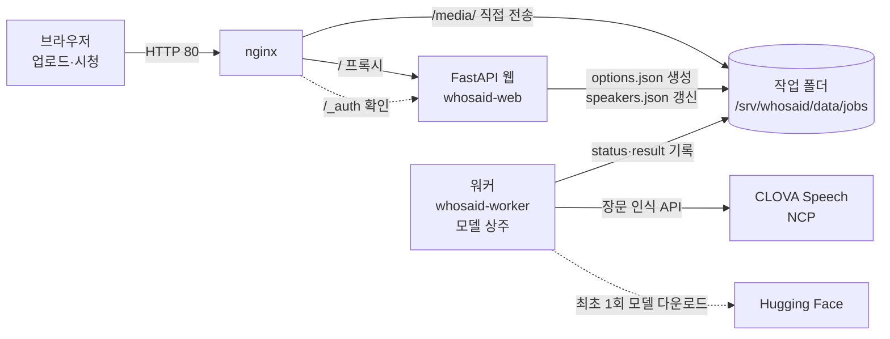
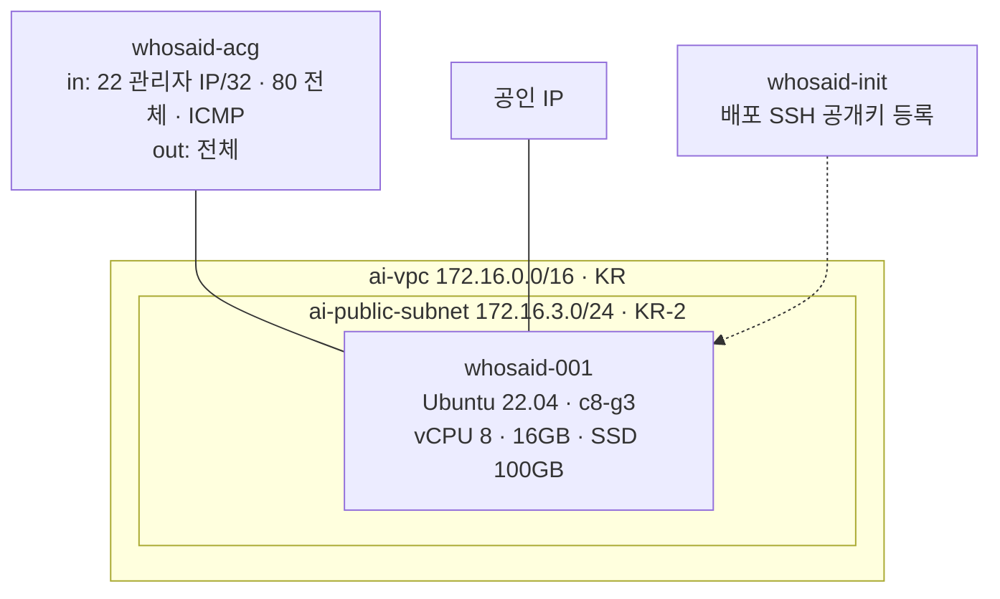
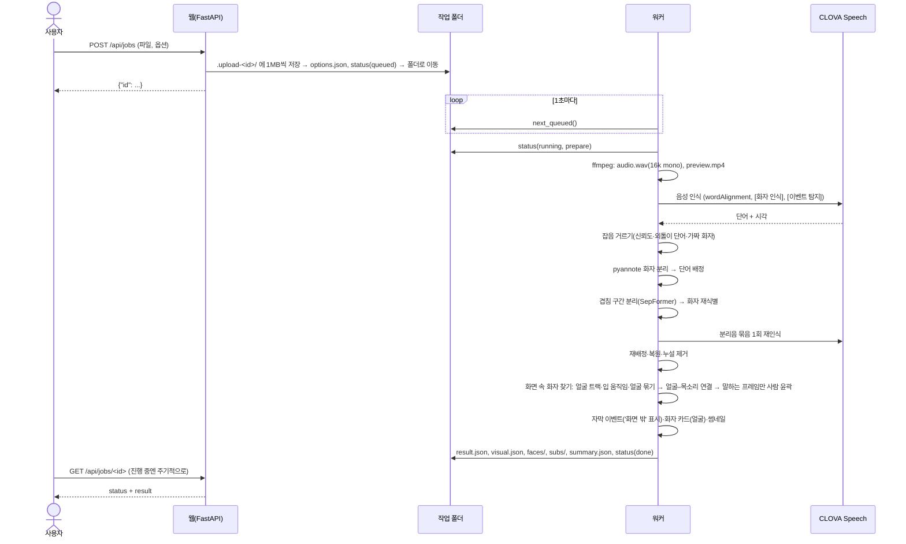
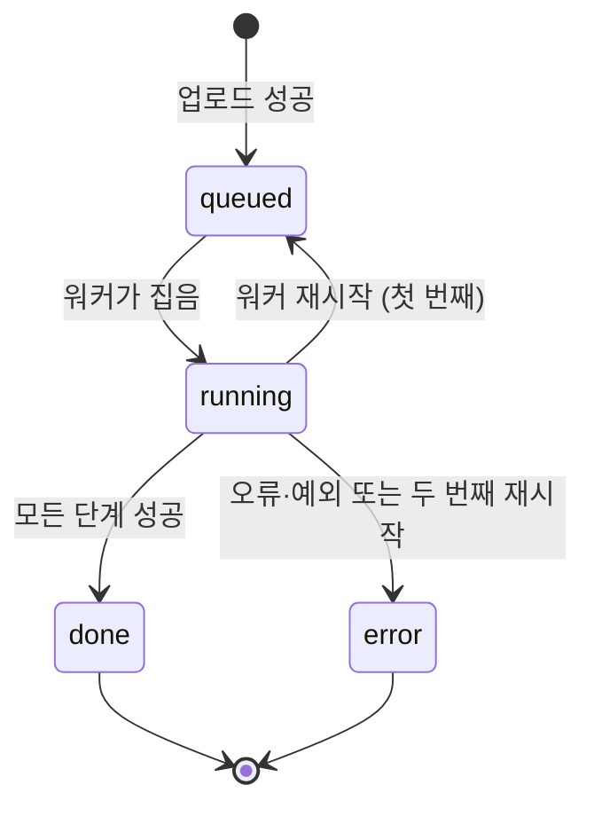

# 02. 상세설계

| 항목 | 내용 |
| --- | --- |
| 문서 상태 | 기준선 v1.0 — 현재 코드(`app/`, `infra/`)와 일치 |
| 최종 수정 | 2026-11-18 |
| 위 문서 | [01 요구사항 분석](01-요구사항-분석.md) |
| 관련 | 기능별 설계는 각 스펙의 `plan.md`, 코드 위치는 [03 기능 구현](03-기능-구현.md) |

> 이 문서는 시스템 전체의 **기준 설계**입니다. 기능을 바꾸면 그 스펙의 `plan.md`에 변경 설계를 쓰고,
> 머지할 때 이 문서의 해당 절을 함께 고칩니다. 코드와 이 문서가 다르면 둘 중 하나가 버그입니다.

## 1. 설계 요약

| 결정 | 내용 | 이유 |
| --- | --- | --- |
| 서버 1대, 프로세스 3개 | nginx + FastAPI 웹(uvicorn 2 workers) + 워커 1개 | 과제 규모·비용. 웹은 가볍게, 무거운 모델은 워커에만 |
| DB 없음 | 작업 1건 = 폴더 1개, JSON 파일로 상태 저장 | 동시 사용자 적음, 백업·디버깅이 쉬움 |
| 파일별 쓰기 주인 | 같은 파일을 두 프로세스가 쓰지 않음 + 원자적 교체 | 잠금 없이 경쟁 조건 회피 |
| 인식은 외부, 분리는 내부 | CLOVA Speech API + 서버 안의 pyannote·SepFormer | 한국어 품질(국내 모델) + 영상 외부 전송 최소화 |
| 겹친 말 배치 재인식 | 분리음을 이어 붙여 API 1회 호출 | 호출 수·지연·비용 감소, 짧은 말도 문맥 덕에 인식 |
| 쿠키 세션 + nginx auth_request | 앱이 인증 판단, nginx는 영상 파일을 직접 전송 | Range 요청 지원, 브라우저 호환(Basic 인증 문제 회피) |

내부 코드명은 `whosaid`입니다(패키지·경로·서비스·NCP 자원 이름). 제품 이름 VoxPrism과 다르지만 운영 중인 서버와 맞추기 위해 바꾸지 않습니다.

## 2. 시스템 구성



| 구성 요소 | 실행 단위 | 하는 일 | 무거운 라이브러리 |
| --- | --- | --- | --- |
| nginx | systemd `nginx` | 80번 수신, 웹 프록시, `/media/` 로그인 확인 후 직접 전송 | — |
| 웹 | systemd `whosaid-web` (uvicorn, 127.0.0.1:8000, workers 2) | 로그인, 업로드, 상태 조회, 화자 편집, 다운로드 | 없음 (numpy까지만) |
| 워커 | systemd `whosaid-worker` (`python -m whosaid.worker`, Nice=5) | 대기열 처리, 모델 추론, 자막 생성, MP4 렌더 | torch, pyannote, speechbrain, faster-whisper |
| 작업 폴더 | 디스크 | 작업별 입력·중간 결과·출력 | — |

## 3. 배포 구성 (NCP)



| 경로 | 내용 | 권한 |
| --- | --- | --- |
| `/opt/whosaid/app` | `app/` 복사본 (deploy.sh가 tar로 올림) | whosaid |
| `/opt/whosaid/venv` | Python 3.12 venv (uv), torch 2.9.1+cpu 고정 | root |
| `/srv/whosaid/data/jobs/<id>/` | 작업 폴더 | whosaid |
| `/srv/whosaid/models` | 모델 캐시 (`HF_HOME=/srv/whosaid/models/hf`) | whosaid |
| `/etc/whosaid.env` | 키·설정 (systemd `EnvironmentFile`) | root:whosaid 640 |
| `/etc/nginx/sites-available/whosaid` | `app/deploy/nginx-whosaid.conf` | root |

운영 스크립트(`infra/`)는 개발 PC에서 실행하며 `infra/state.env`(자원 번호·공인 IP)와 `secrets/`(키·SSH 키)를 읽습니다. 둘 다 저장소에 올리지 않습니다.

## 4. 처리 흐름



## 5. 작업 저장소

작업 하나는 폴더 하나입니다. 작업 ID는 `YYYYMMDD-HHMMSS-<6 hex>`(정규식 `^\d{8}-\d{6}-[0-9a-f]{6}$`)라서 이름순 = 접수순입니다.

### 5.1 파일과 쓰기 주인

| 파일 | 쓰는 쪽 | 시점 | 내용 |
| --- | --- | --- | --- |
| `input.<ext>` | 웹 | 업로드 | 원본 |
| `options.json` | 웹 | 생성 시 1회 | 제목, 출연자 수, 엔진, 복원·소리 자막 여부, 원본 이름, 크기, `created_at` |
| `status.json` | 워커 (생성만 웹) | 진행 중 계속 | 아래 5.2 |
| `audio.wav`, `preview.mp4` | 워커 | prepare | 16kHz 모노 / 브라우저 재생용 |
| `asr.json`, `asr_raw.json` | 워커 | asr | 엔진, 단어, 소리 이벤트, 경고 / CLOVA 원본 응답 |
| `diarization.json` | 워커 | diarize | 모델, turns, exclusive, overlaps |
| `overlap.json` | 워커 | overlap | 구간 수, 처리 수, 복원 단어 수, 구간별 판정 |
| `result.json` | 워커 | captions | 아래 5.3 |
| `summary.json` | 워커 | 완료 | 목록 화면용 요약 (길이, 화자 수, 복원 줄 수) |
| `subs/whosaid.{srt,vtt,ass}` | 워커·웹 | 완료·화자 편집 | 자막 파일 (`subtitles.write_all`) |
| `thumbs/S<n>_<k>.jpg` | 워커 | captions | 화자 장면 (가로 480) |
| `visual.json` | 워커 | visual | 말하는 사람 윤곽·얼굴–목소리 연결·화자별 보이는 구간 (9.2절, SPEC-009) |
| `faces/P<n>.jpg` | 워커 | visual | 얼굴과 연결된 사람의 얼굴 사진(화자 카드) |
| `subs/burn.ass` | 워커 | 렌더 | 자막 입힌 MP4용 ASS(내려받기 대상 아님) |
| `speakers.json` | 웹 | 화자 편집 | `{S1: {name, merge_into}}` |
| `render.request` | 웹 생성 / 워커 삭제 | MP4 요청 | 요청 시각 |
| `render.json`, `burned.mp4` | 워커 (웹은 편집 시 삭제) | 렌더 | 렌더 상태 / 자막 입힌 영상 |
| `job.log` | 워커 | 처리 중 | 작업별 로그 |

모든 JSON 쓰기는 `<파일>.<pid>.tmp`에 쓴 뒤 `os.replace`로 바꿉니다(`store.write_json`). 읽는 쪽은 반쯤 쓴 파일을 보지 않습니다.

### 5.2 status.json

```jsonc
{
  "state": "running",            // queued | running | done | error
  "stage": "overlap",            // queued | prepare | asr | diarize | overlap | captions | done
  "progress": 71.4,              // 0~100, 단계별 구간: prepare 0-8, asr 8-32, diarize 32-60, overlap 60-88, captions 88-99
  "message": "겹친 말 11곳을 분리하고 있어요",
  "warnings": [],
  "started_at": 1794937000.1, "finished_at": null, "updated_at": 1794937050.3,
  "timings": {"prepare": 4.1, "asr": 6.2, "diarize": 40.3, "overlap": 38.0, "captions": 2.2, "total": 90.8},
  "retries": 0,                  // 재시작 복구 횟수
  "detail": "TypeError: ..."     // 예상 못 한 오류일 때만
}
```

진행률은 0.7초보다 자주 쓰지 않습니다(`Progress.__call__`, 단계 시작은 `force`).

### 5.3 result.json

```json
{
  "job_id": "20261118-031253-c75da8",
  "engine": "clova", "diarization_model": "pyannote/speaker-diarization-community-1",
  "video": {"width": 1280, "height": 720, "has_video": true},
  "speakers": [
    {"id": "S1", "raw": "SPEAKER_01", "name": "화자 1", "color": "#FFD84D", "talk_time": 31.2,
     "lines": 14, "recovered_lines": 3, "samples": ["…", "…"],
     "thumbs": [{"file": "thumbs/S1_0.jpg", "t": 12.4}]}
  ],
  "events": [
    {"id": 0, "speaker": "S1", "start": 0.52, "end": 2.31, "text": "오늘 저녁 뭐 먹지?",
     "overlap": true, "recovered": false, "uncertain": false}
  ],
  "stats": {"duration": 74.0, "speakers": 3, "lines": 41, "overlap_regions": 11, "overlap_seconds": 9.8,
            "overlap_lines": 18, "recovered_lines": 6, "reassigned_words": 4, "sound_lines": 0},
  "timings": {"prepare": 4.1, "asr": 6.2, "diarize": 40.3, "overlap": 38.0, "captions": 2.2, "total": 90.8}
}
```

`speaker`는 `S<n>`, 소리 자막은 `_sfx`, 배정 못 한 말은 `UNK`입니다. 사용자 편집은 `result.json`을 고치지 않고 `speakers.json`에 따로 두며, 읽을 때 `captions.resolve_speakers`로 합칩니다(병합은 최대 10단계 따라감).

## 6. 상태 전이



`error`로 가는 길은 두 가지입니다. 처리 중 `UserError`(오디오 트랙 없음·길이 초과·인식된 말소리 없음)나 다른 예외가 난 경우, 그리고 워커 재시작으로 이미 한 번 다시 대기열에 들어갔던 작업(`retries` = 1)이 또 중단된 경우입니다(`store.recover_interrupted`).

MP4 렌더는 따로 움직입니다: 요청 없음 → `queued`(render.request 있음) → `running` → `done` | `error`. 화자 편집 시 `render.json`·`burned.mp4`를 지워 처음 상태로 돌아갑니다.

## 7. 파이프라인 단계

| 단계 | 함수 | 입력 → 출력 | 핵심 파라미터 |
| --- | --- | --- | --- |
| 1 준비 | `media.probe`, `extract_audio`, `make_preview` | 원본 → `audio.wav`, `preview.mp4` | 16kHz 모노 PCM, 최대 720p, H.264 호환이면 복사 |
| 2 음성 인식 | `asr.recognize` | wav → 단어 `{start,end,text,src_spk?}` | 엔진 선택 `resolve_engine`, 이벤트 탐지 auto |
| 3 화자 분리 | `diarize.diarize` | wav → turns, exclusive | community-1 (실패 시 3.1), 출연자 수 고정 |
| 3' 겹침 구간 | `diarize.overlap_regions` | turns → overlaps | 0.25초 이상, 0.2초 간격 병합 |
| 4 단어 배정 | `assign.assign_words` | 단어 + exclusive/turns → 단어.speaker | 중앙 → 최대 겹침 → 1초 이내 최근접 |
| 5 겹친 말 복원 | `overlap.*` | wav, overlaps, 단어 → 재배정·복원 단어 | 8절 |
| 6 자막 | `captions.build_events`, `run.build_speakers`, `run._thumbnails` | 단어 → 이벤트, 화자 카드 | 9절 |

엔진·모델 대체 경로:

| 실패 | 대체 | 사용자에게 |
| --- | --- | --- |
| CLOVA 키 없음 | faster-whisper (`deepdml/faster-whisper-large-v3-turbo-ct2`, CPU int8) | 진행 문구가 Whisper로 표시 |
| CLOVA 호출 실패 | faster-whisper | 경고 |
| 이벤트 탐지 미지원 도메인 | 탐지 없이 재요청, 워커가 기억 | 경고 |
| pyannote 실패 | CLOVA 화자 인식(필요하면 화자 인식 켜고 재요청) | 경고 |
| 둘 다 불가 | 단일 화자 | 경고 |
| 겹친 말 재인식 CLOVA 실패 | faster-whisper (VAD 끔) | — |

## 8. 겹친 말 복원 알고리즘

```text
입력: wav, overlaps(≥ 2명 동시 구간), turns, 단어(화자 배정됨)
cents ← speaker_centroids(혼자 말한 1~6초 조각을 길이순 최대 8개 → wespeaker 임베딩 평균, 정규화)
for 구간 r in overlaps (길이 ≥ 0.4초, 화자 대표 벡터 ≥ 2개):
    창 ← [r.start − 1.5, r.end + 1.5] (최대 12초)
    (s0, s1) ← SepFormer(창)                         # 두 목소리
    e_i ← embed(s_i 중 r ± 0.5초, 최소 1.2초)
    score[i][j] ← cos(e_i, cents[j]) + (j ∈ r.speakers ? 0.05 : 0)
    (A, B) ← 서로 다른 두 화자 중 score 합 최대, 단 적어도 하나는 r.speakers
    match_conf ← (1위 합 − 2위 합) / 2
batch.wav ← 분리음들을 1.2초 무음 사이에 이어 붙임 (큰 쪽보다 18dB 넘게 작은 조각 제외)
words' ← 재인식(batch.wav) → 오프셋으로 (구간, 조각)별 단어에 되돌림
for 구간 r:
    if 두 분리음 텍스트 유사도 ≥ 0.6: 에너지 작은 쪽 버림          # 분리 실패
    uncertain ← match_conf < 0.05
    if not uncertain:                                                 # 재배정
        원래 단어 w마다: ±0.8초 안 유사도 sa, sb
        if max ≥ 0.6 and |sa − sb| ≥ 0.2 and 주인이 다르면 → 옮김
    for 화자 X in (A, B):                                             # 복원
        new ← X 분리음 단어 중 X의 원래 단어(r ± 1초)와 유사도 < 0.6
        if new 가 상대 화자 원래 말과 유사도 ≥ 0.6: 버림            # 누설
        else: new를 recovered(uncertain 표시 포함)로 추가
```

유사도는 공백·문장부호를 뺀 글자열의 `difflib.SequenceMatcher` 비율입니다(`overlap.similarity`). 구간별 판정(`reassign`, `recover`, `keep`)과 근거(유사도, 에너지, 이동 단어 수)는 `overlap.json`에 남습니다.

**설계 이력:** 1차 버전은 구간에 표시된 두 화자에게만 분리음을 붙였고, cpCER이 0.357 → 0.421로 나빠졌습니다. 겹친 구간의 두 번째 화자 표시가 자주 틀렸기 때문입니다. 전체 화자 재식별(가산점 0.05), 단어 단위 판정, 같은 화자 중복 제거, 자막 쪼개짐 수정(`TURN_PAUSE`)을 넣은 2차 버전에서 같은 영상이 0.238이 됐습니다.

## 9. 자막 생성

| 규칙 | 값 | 위치 |
| --- | --- | --- |
| 한 줄 / 이벤트 최대 글자 | 16 / 32 | `LINE_MAX`, `EVENT_MAX` |
| 이벤트 최대 길이 | 6초 | `MAX_DUR` |
| 같은 화자 단어 간격이 이보다 크면 새 이벤트 | 0.8초 | `MAX_GAP` |
| 다른 화자가 이만큼 쉬면 그 화자 이벤트를 닫음(턴 교대) | 0.3초 | `TURN_PAUSE` |
| 문장 끝(`.?!…~`)이고 8자 이상이면 닫음 | — | `SENT_END` |
| 최소 표시 / 읽기 속도 | 0.8초 / 초당 12자 (늘려도 원래 끝 + 1.5초, 같은 화자 다음 자막 0.05초 전까지) | `_polish_timing` |
| 동시 표시 판정 | 다른 화자 이벤트와 0.15초 이상 겹침 | `mark_overlaps` |
| 복원 단어는 원래 단어와 같은 이벤트에 섞지 않음 | — | `build_events` |

| 형식 | 화자 표시 | 비고 |
| --- | --- | --- |
| SRT | `[이름] ` 접두 | UTF-8 BOM(윈도 플레이어 한글 깨짐 방지), 줄 22자 감싸기 |
| WebVTT | `<v 이름>` + `::cue(.S1){color}` STYLE | 배경 rgba(0,0,0,.75) |
| ASS | 화자별 Style(색), BorderStyle 3 반투명 상자, 글자 높이 5.2% | 폰트 Noto Sans CJK KR, 소리 자막은 위쪽(Alignment 8) |
| 자막 입힌 MP4용 ASS(`subs/burn.ass`) | 9.1절 | 렌더할 때마다 새로 씀, 내려받기 대상 아님 |

### 9.1 고정 줄 말풍선 (SPEC-008, 위치·표시는 SPEC-009에서 바뀜)

웹(`job.js`)과 MP4(`captions.to_ass_burn`)가 같은 규칙을 씁니다. SPEC-009부터 줄은 **영상 위쪽**에서 아래로 쌓이고(첫 줄이 맨 위),
아래 표의 화자 표시줄·칩·꼬리·선은 없어졌습니다(말하는 사람은 9.2절 윤곽으로 표시).

| 규칙 | 값 | 위치 |
| --- | --- | --- |
| 줄 수 | 대화 자막의 최대 동시 개수(소리 자막 제외) | `assignLanes` / `assign_lanes` |
| 줄 배정 | (start, id) 순서로, 끝난 줄(end ≤ start) 중 가장 아래, 없으면 새 줄. 끝날 때까지 유지 | 같음 |
| 화자 표시줄 | `result.speakers` 순서, 합친 화자는 최종 id 하나, `_sfx`·`UNK` 제외. 칩 중심 x = 폭 × (i + 0.5) / n | `renderStage` / `to_ass_burn` |
| 칩 켜짐 | 그 화자(합친 화자 포함)의 대화 자막이 떠 있는 동안 | `tick` / 칩 강조 이벤트(구간 병합) |
| 꼬리 x | 칩 중심 x를 [말풍선 왼쪽 + r, 오른쪽 − r]로 자름(r = 0.9em) | `layoutLinks` / `to_ass_burn` |
| MP4 크기 | 글자 = 짧은 변 × 4.6%, 칩 글자 0.72배, 표시줄 아래 여백 = 높이 × 4.5% | `to_ass_burn` |
| MP4 줄 높이 | 가장 긴 자막이 필요한 줄 수(최대 3) × 글자 크기 + 안쪽 여백. 폭은 Noto Sans CJK KR Bold로 재고 libass 기준(ascent+descent)으로 보정 | `_Measure`, `_fit_lines` |
| MP4 층(Layer) | 0–1 선, 2 말풍선 도형, 3 글자·꼬리, 4–5 칩(평소), 6–8 칩(켜짐), 9 소리 자막 | `to_ass_burn` |

### 9.2 화면 속 화자 찾기 (SPEC-009)

| 단계 | 방법 | 값 | 위치 |
| --- | --- | --- | --- |
| 프레임 | `ffmpeg fps=…,scale` → BGR 원시 프레임 파이프 | 짧은 변 480, 얼굴 10fps, 윤곽 5fps | `read_frames`, `frame_size` |
| 장면 전환 | 64×36 흑백 히스토그램(32칸) 차이의 절반 | > 0.35 | `analyze` |
| 얼굴 | YuNet(ONNX) 상자 + 5점(눈·코·입꼬리) | 점수 ≥ 0.75, 폭 < 17px 버림 | `cv2.FaceDetectorYN` |
| 트랙 | 직전 프레임과 IoU 큰 순 짝짓기, 장면 전환·0.35초 공백에서 끊음 | IoU ≥ 0.3, 3프레임 이상 | `link_tracks` |
| 입 움직임 | 입 조각(입꼬리 폭 1.6×1.1)과 눈 조각을 32×20으로 줄여 정규화, 연속 프레임 평균 절대 차이 | 입 − 0.6×눈 | `mouth_and_eye_crops`, `set_activity` |
| 얼굴 묶기 | SFace 특징(초당 2번, 폭 ≥ 42px) → 트랙별 큰 얼굴 5장 평균 → 평균 연결 군집 | 코사인 ≥ 0.42 | `cluster` |
| 연결 | 9.2.1 | 근거 ≥ 1.5초 | `associate` |
| 윤곽 | 연결된 사람이 보이고 그 목소리가 나오는 5fps 프레임만 YOLO11n-seg(640, ONNX Runtime). 얼굴 가운데를 품고 얼굴이 위쪽에 있는 사람 마스크 → 가장 큰 윤곽 → 다각형 ≤ 64점(0~1 좌표). 없으면 얼굴 타원 | 사람 점수 ≥ 0.35, NMS 0.5 | `PersonSeg`, `pick_person`, `outline` |
| 화면 밖 | 연결 안 된 화자, 또는 자막 시간 중 얼굴이 보인 비율 < 30%. 얼굴 트랙이 없는 영상은 표시 안 함 | 0.3 | `offscreen_flags` |

#### 9.2.1 얼굴–목소리 연결

`exclusive`(한 사람만 말하는 구간)를 기준으로, 사람 P가 보인 프레임마다 그때 혼자 말하는 화자를 봅니다.

- `cooc(P,S)` = P가 보이며 누군가 말한 프레임 중 S가 말한 비율
- `within(P,S)` = (S가 말할 때 − 아닐 때) P의 입 움직임 평균 차 / 전체 입 움직임 표준편차
- `multi(P,S)` = 여러 얼굴이 함께 보이며 S가 말할 때, P의 입 움직임 − 다른 얼굴 평균 (표준편차 단위)
- `score = cooc + 0.3·clip(within, ±2) + 0.3·clip(multi, ±2)`
- 연결 조건: 근거 ≥ 1.5초, cooc ≥ 0.5, score ≥ 0.6, within ≥ −0.3, multi ≥ −0.5 → 점수 순 1:1. 점수표는 `visual.json.scores`에 남깁니다.

개발 샘플(2인 인터뷰 150초)에서 맞는 쌍 1.01·0.88, 틀린 쌍 0.07·−0.19로 갈렸습니다. 한 장면에 한 사람만 나오는 편집이 많아
`within`만으로는 차이가 작았고(±0.1), 함께 걷는 장면의 `multi`(+0.55 / −1.04)와 `cooc`가 결정적이었습니다.

#### 9.2.2 visual.json

```jsonc
{
  "version": 1, "fps": 5, "size": [854, 480],
  "people": [{"id": "P1", "speaker": "S2", "seconds": 26.6, "tracks": 7}],
  "speaker_face": {"S2": "P1"},                 // 화자 → 사람
  "scores": [{"person": "P1", "speaker": "S2", "score": 1.014, "cooc": 0.857, "within": -0.023, "multi": 0.547, "support": 21.0}],
  "visible": {"S2": [[8.5, 11.6], [29.9, 34.1]]}, // 그 화자 얼굴이 보인 구간
  "any_face": true,
  "frames": [{"t": 40.0, "hl": [{"spk": "S2", "poly": [[0.81, 0.10], ...], "face": [0.82, 0.13, 0.05, 0.12]}]}]
}
```

얼굴 특징값(벡터)은 저장하지 않습니다(NFR-PRIV-02).

## 10. API

모든 응답은 JSON입니다(파일 다운로드 제외). 오류는 `{"detail": "<사용자에게 보여 줄 문구>"}`.

| 메서드·경로 | 인증 | 요청 | 응답 | 요구사항 |
| --- | --- | --- | --- | --- |
| `GET /api/health` | 공개 | — | `{ok, version, clova_speech, pyannote, max_minutes, max_upload_mb}` | — |
| `GET /api/auth-check` | 공개 | 쿠키 또는 Basic | 204 / 401 (nginx용) | FR-AUTH-03 |
| `GET·POST /login`, `POST /logout` | 공개 | form `password`, `next` | 303 | FR-AUTH-01, 05 |
| `POST /api/jobs` | 필요 | multipart `file`, `title`, `num_speakers`, `engine`, `recover_overlap`, `sound_events` | `{id}` / 400 / 413 | FR-JOB-01~02 |
| `GET /api/jobs` | 필요 | — | `{jobs: [{id, title, created_at, state, progress, message, duration?, speakers?, recovered_lines?}]}` | FR-JOB-06 |
| `GET /api/jobs/{id}` | 필요 | — | `{id, title, options, status, render, result?}` (`result`는 done일 때, 화자에 `display`·`merge_into` 포함) | FR-JOB-04 |
| `POST /api/jobs/{id}/speakers` | 필요 | `{speakers: [{id, name?, merge_into?}]}` | 갱신된 작업 / 409(미완료) | FR-VIEW-05 |
| `POST /api/jobs/{id}/render` | 필요 | — | `{render: {state: "queued"}}` / 409 | FR-VIEW-07 |
| `GET /api/jobs/{id}/download/{srt\|vtt\|ass\|json\|mp4}` | 필요 | — | 파일 (`<제목>.srt`, `<제목>_자막영상.mp4`) / 404 | FR-VIEW-06 |
| `DELETE /api/jobs/{id}` | 필요 | — | `{ok}` / 409(처리 중) | FR-JOB-06 |
| `GET /media/{id}/{preview.mp4\|burned.mp4\|thumbs/…}` | 필요 | Range | 파일 (운영: nginx 직접) | FR-AUTH-03 |
| `GET /`, `GET /jobs/{id}` | 필요 | — | 정적 HTML | FR-VIEW |

잘못된 작업 ID 형식은 `ValueError` → 400, 없는 작업은 404입니다.

## 11. 보안 설계

| 위협 | 대응 | 위치 |
| --- | --- | --- |
| 키 유출 | 키는 `secrets/keys.env`(600)에만. 서버에는 `/etc/whosaid.env`(640). 스크립트는 값을 출력하지 않음. 저장소는 `.gitignore` + pre-commit 훅 + CI 비밀 스캔 | `infra/deploy.sh`, `.githooks/pre-commit` |
| 무단 접근 | 공유 비밀번호 로그인, 세션 쿠키 `exp.HMAC-SHA256(exp)[:40]` (HttpOnly, SameSite=Lax, 7일), 비교는 `hmac.compare_digest` | `web/main.py` |
| 무차별 대입 | 실패 시 1초 지연 | `login()` |
| 오픈 리다이렉트 | `next`는 `/`로 시작하고 `//`가 아닐 때만 | `_safe_next` |
| 경로 조작 | 작업 ID 정규식, 미디어 경로 화이트리스트(앱·nginx 양쪽) | `store.job_dir`, `MEDIA_RE`, nginx `location ~` |
| 서버 침입 | SSH는 관리자 공인 IP/32만, 키 인증만 | ACG `whosaid-acg` |
| 과대 업로드 | 1MB씩 받으며 누적 크기 검사, nginx `client_max_body_size 1100m` | `create_job` |

알려진 약점: HTTPS가 아닙니다(공인 IP + 80번). 비밀번호가 평문으로 오가므로 시연용으로만 씁니다. 도메인을 붙이면 Let's Encrypt로 바꿉니다.

## 12. 설정 (환경 변수)

| 변수 | 기본값 | 뜻 |
| --- | --- | --- |
| `WHOSAID_DATA_DIR` | `/srv/whosaid/data` | 작업 폴더의 부모 |
| `WHOSAID_MODEL_DIR` | `/srv/whosaid/models` | 모델 캐시 |
| `CLOVA_SPEECH_INVOKE_URL`, `CLOVA_SPEECH_SECRET` | — | CLOVA Speech 도메인 |
| `WHOSAID_CLOVA_SED` | `auto` | 이벤트 탐지: auto(시도 후 미지원이면 끔) · off |
| `HF_TOKEN` | — | pyannote 모델 다운로드 |
| `WHOSAID_DIAR_MODEL`, `WHOSAID_EMB_MODEL`, `WHOSAID_SEP_MODEL`, `WHOSAID_WHISPER_MODEL` | 1절 모델들 | 모델 교체 |
| `CLOVASTUDIO_API_KEY` | — | 예비(현재 미사용) |
| `WHOSAID_WEB_PASSWORD` | — | 비어 있으면 로그인 없음(개발용) |
| `WHOSAID_SECRET` | 비밀번호 기반 | 세션 서명 키 |
| `WHOSAID_SESSION_DAYS` | 7 | 세션 유지 |
| `WHOSAID_MAX_DURATION_SEC` / `WHOSAID_MAX_UPLOAD_MB` | 1200 / 1024 | 입력 한도 |
| `WHOSAID_THREADS` | CPU 수 | torch·whisper 스레드 |

## 13. 성능

실측(c8-g3, 59~74초 테스트 영상 3개): 전체 72~91초. 단계별로 CLOVA 인식 약 6초, pyannote 약 40초, 겹친 말 단계 약 40초입니다. 화자 분리가 CPU 병목이며, 복원을 끄면 영상 길이의 약 0.6배가 걸립니다. 워커는 시작할 때 pyannote·임베딩·SepFormer(키가 없으면 Whisper도)를 미리 올립니다.

## 14. 테스트 전략

| 층 | 무엇 | 언제 |
| --- | --- | --- |
| 단위 테스트 (`app/tests`) | 겹침 계산, 단어 배정, 자막 이벤트, 복원 판정, 화자 재식별, 배치 매핑, 자막 파일·병합, 웹 API·로그인 | 모든 PR (CI `test`, 모델 없이 약 3초) |
| 평가 (`app/tools`) | 합성 평가셋 cpCER·겹친 발화 재현율 | 파이프라인(SPEC-002·003)을 바꾸는 PR — 결과를 PR에 첨부 |
| 화면 확인 | 업로드·진행·자막 오버레이·편집·다운로드 | UI를 바꾸는 PR — 스크린샷 첨부 |

## 15. 결정 기록

| # | 날짜 | 결정 | 버린 대안 | 근거 |
| --- | --- | --- | --- | --- |
| D-01 | 2026-11-17 | 한국어 인식은 CLOVA Speech, 대체는 faster-whisper | Whisper만 | 소버린 AI 과제, 한국어 품질, 키 없는 개발 환경 |
| D-02 | 2026-11-17 | pyannote community-1을 CPU에서 | NeMo, 3.1 | 품질·라이선스·배타 구간 출력 |
| D-03 | 2026-11-17 | 서버 c8-g3(CPU) 시간 요금제 | GPU 서버 | 비용. 1.2배 실시간이면 시연에 충분 |
| D-04 | 2026-11-17 | 작업 = 폴더 + JSON, DB 없음 | SQLite·Redis 큐 | 단일 서버·단일 워커, 단순함 |
| D-05 | 2026-11-18 | 겹친 말 v2: 전체 화자 재식별 + 단어 단위 판정 | v1(구간 표시 화자에 바로 배정) | v1이 cpCER을 악화(0.357→0.421) |
| D-06 | 2026-11-18 | nginx Basic 인증 → 앱 로그인 + auth_request | Basic 인증 유지 | 내장 브라우저가 URL 자격 증명을 버려 401 |
| D-07 | 2026-11-18 | torch 2.9.1+cpu 고정 | 최신(CUDA 휠) | uv가 CUDA torch를 받아 venv 6.1GB → 고정 후 1.9GB |
| D-08 | 2026-11-18 | 제품명 VoxPrism, 내부 코드명 whosaid 유지 | 전부 개명 | 운영 중인 서버 경로·서비스·NCP 자원과 맞춤 |
| D-09 | 2026-11-19 | 자막을 고정 줄 말풍선 + 화자 표시줄(칩 강조·꼬리·선)로 표시, MP4도 같은 모양 | 가운데 쌓기, 화자별 열, 얼굴 위 말풍선 | 동시 발화 때 줄이 밀리지 않게(사용자 요청). 얼굴 위 표시는 얼굴-화자 연결이 없어 보류 |
| D-10 | 2026-11-19 | 말하는 사람을 영상 속 몸 윤곽으로 강조, 자막은 위쪽 고정, 화자 표시줄 없앰(D-09 일부 대체) | 표시줄 유지 | 사용자 요구: 화면 속 사람과 자막을 같은 색으로 바로 잇기 |
| D-11 | 2026-11-19 | 얼굴–목소리 연결은 동시 출현 + 입 움직임 대비 점수, 확신 없으면 연결 안 함 | TalkNet 등 학습 모델, 동시 출현만 | CPU 시간·검증 비용, 내레이션 B-roll 오연결 방지 |
| D-12 | 2026-11-19 | 얼굴 YuNet·SFace(OpenCV, Apache-2.0), 사람 분할 YOLO11n-seg ONNX(AGPL-3.0 가중치) | Mask R-CNN(느림) | CPU 속도. 라이선스는 SPEC-009 열린 질문 |
| D-13 | 2026-11-19 | Whisper에는 디코딩한 배열을 넘김 | PyAV 버전 고정 | faster-whisper 1.2.1 + PyAV 19 비호환, 의존성 고정보다 단순 |

새 결정은 표 아래에 번호를 이어 붙입니다. 결정을 뒤집을 때도 지우지 않고 새 줄로 남깁니다.

## 16. 알려진 한계

- 화자 분리·음원 분리 모델은 영어 대화로 학습됐고, 배경음악·웃음소리에서 분리 품질이 떨어질 수 있습니다.
- 3명 이상이 동시에 말하면 2명만 복원합니다.
- 출연자 수를 자동으로 두면 화자를 적게 잡는 경우가 있습니다(평가 3개 중 2개).
- CLOVA Speech 도메인의 이벤트 탐지가 꺼져 있어 소리 자막은 지금 나오지 않습니다.
- HTTP만 지원합니다(11절).
- 말하는 사람 강조는 얼굴이 보여야 합니다. 뒷모습·심한 옆모습·작은 얼굴은 강조되지 않고, 그 자막에는 '화면 밖'이 붙을 수 있습니다.
- 얼굴–목소리 연결은 "편집이 말하는 사람을 비춘다"는 성질에 기대므로, 말 없는 사람 위 긴 내레이션이 많은 영상에서는 틀릴 수 있습니다(입 움직임 대비로 일부 막음).
- 사람 기억은 영상 한 편 안에서만입니다.
