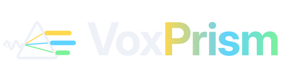

# 04. 디자인

| 항목 | 내용 |
| --- | --- |
| 문서 상태 | 기준선 v1.0 |
| 최종 수정 | 2026-11-18 |
| 관련 | 화면 동작은 [SPEC-004](../specs/004-caption-viewer/spec.md), 자막 규칙 수치는 [02 상세설계 9절](02-상세설계.md#9-자막-생성) |

디자인의 기준은 하나입니다. **소리 없이 봐도 누가 무슨 말을 했는지 한눈에 보여야 한다.**

## 1. 브랜드

<p>
  
</p>

| 항목 | 내용 |
| --- | --- |
| 이름 | **VoxPrism** (복스프리즘). Vox(라틴어 '목소리') + Prism |
| 뜻 | 섞여 들어온 목소리를 프리즘처럼 화자별 '색'으로 갈라 보여 준다 |
| 한 줄 소개 | 겹친 말까지, 누가 말했는지 보이게 |
| 영문 소개 | Speaker-aware captions for overlapping speech |
| 마크 | 왼쪽에서 겹친 두 음파가 프리즘으로 들어가, 오른쪽에서 화자 색의 자막 줄 3개로 나온다 |
| 글자 로고 | Inter Display Bold. 'Vox'는 본문색, 'Prism'은 화자 색 3개(노랑→하늘→초록) 그러데이션 |

### 1.1 에셋

모든 SVG는 글자를 패스로 바꿔 넣어 폰트 없이도 똑같이 보입니다. 다시 만들 때는 `python3 assets/brand/gen.py`(Inter Display, Noto Sans CJK KR, rsvg-convert 필요).

| 파일 | 크기 | 쓰는 곳 |
| --- | --- | --- |
| `assets/brand/banner.png` (`.svg`) | 1280×640 | README 머리, GitHub 소셜 미리보기 |
| `assets/brand/logo-dark.svg` / `logo-light.svg` | 가로 로고 | 어두운 / 밝은 배경 문서 |
| `assets/brand/mark-dark.svg` / `mark-light.svg` | 512×512, 투명 | 마크만 필요할 때 |
| `assets/brand/avatar.png` (`.svg`) | 500×500 | GitHub 조직 프로필 사진 |
| `assets/brand/favicon.svg`, `app/.../static/brand/favicon.svg` | 512×512 단순형 | 브라우저 탭, 웹 화면 머리의 로고 |
| `app/.../static/brand/apple-touch-icon.png` | 180×180 | 휴대폰 홈 화면 |

**지키기:** 비율을 바꾸지 않습니다. 마크의 세 줄 색 순서(노랑·하늘·초록)는 화자 S1·S2·S3 색과 같으므로 바꾸지 않습니다. 작은 크기(32px 이하)에서는 음파가 없는 단순형(`favicon.svg`)을 씁니다.

## 2. 색

### 2.1 화면 색 (`app.css` 변수)

| 변수 | 값 | 쓰임 |
| --- | --- | --- |
| `--bg` | `#0f1115` | 바탕 (어두운 화면이 기본: 영상 감상에 맞춤) |
| `--panel` / `--panel2` | `#171a21` / `#1e222b` | 카드, 입력칸 |
| `--line` | `#2b313c` | 테두리 |
| `--text` / `--muted` | `#eef1f6` / `#a3acba` | 본문 / 보조 글자 (바탕 대비 18.9 / 8.2) |
| `--accent` | `#4fb3ff` | 링크, 주 버튼 (대비 8.3) |
| `--accent2` | `#ffd84d` | 로고 'Prism', 강조 |
| 브랜드 남색 | `#0B1020` → `#16203F` | 배너·아바타 배경 |

### 2.2 화자 색

S1부터 차례로 씁니다(`captions.PALETTE`). 자막은 반투명 검은 상자(78%) 위에 쓰므로, 가장 나쁜 경우(흰 영상 위)에도 대비 4.5:1을 넘습니다.

| 화자 | 색 | 대비(검정 바탕) | 대비(흰 영상 위 상자) |
| --- | --- | --- | --- |
| S1 | `#FFD84D` 노랑 | 15.2 | 7.5 |
| S2 | `#5FD3FF` 하늘 | 12.2 | 6.0 |
| S3 | `#7CF29A` 초록 | 15.0 | 7.4 |
| S4 | `#FF9F5A` 주황 | 10.4 | 5.1 |
| S5 | `#FF8FD8` 분홍 | 10.2 | 5.0 |
| S6 | `#B8A6FF` 보라 | 9.9 | 4.9 |
| S7 | `#9FE8E0` 청록 | 15.1 | 7.5 |
| S8 | `#F2B5A0` 살구 | 11.9 | 5.9 |
| S9 | `#C8F07A` 연두 | 16.2 | 8.0 |
| S10 | `#FFFFFF` 흰색 | 21.0 | 10.4 |
| 소리 | `#DDDDDD` 회색 | 15.5 | 7.6 |

색만으로 화자를 구분하지 않습니다(색각 이상 대비). 모든 자막 줄에 **이름표**가 붙고 기본으로 켜져 있습니다. 이름표를 끄면 줄 왼쪽 색 막대로만 구분되므로, 이름표 끄기는 사용자가 고르는 선택으로만 둡니다.

## 3. 자막 디자인

[SPEC-008](../specs/008-fixed-bubble-captions/spec.md)부터 자막은 **고정 줄 말풍선 + 화자 표시줄**입니다.

```text
   줄 1 →      ╭────────────────────────────╮
               │ [게스트 1?] 치킨 먹자, 치킨! │   ← 늦게 시작한 말: 위 줄. 끝날 때까지 이 자리
               ╰──────────────────────▼─────╯
   줄 0 →   ╭───────────────────────────│──╮
            │ [진행자] 오늘 저녁 뭐 먹지? │  │   ← 먼저 시작한 말: 아래 줄(비어 있는 가장 아래)
            ╰────▼─────────────────────│──╯
                 │                     ╲        ← 꼬리 끝에서 칩까지 같은 색 선(말풍선 뒤로 지나감)
   표시줄 → (● 진행자)   (● 게스트 1)   (● 게스트 2)
             노랑으로 켜짐  초록으로 켜짐   꺼짐(흐림)
```

| 요소 | 규칙 | 구현 |
| --- | --- | --- |
| 말풍선 | 검정 90%, 모서리 0.6em, 화자 색 테두리 0.13em, 글자도 화자 색 | `.cap` |
| 꼬리·선 | 말풍선 아래(위치 '위'면 위) 삼각형, x는 그 화자 칩 쪽(말풍선 폭 안). 꼬리 끝→칩 중앙까지 화자 색 선 + 어두운 테두리 | `.cap::after`, `layoutLinks` |
| 줄(lane) | 그 영상의 최대 동시 자막 수만큼. 시작 순서대로 비어 있는 가장 아래 줄, 끝날 때까지 유지. 빈 줄도 자리를 지킴 | `assignLanes`, `.lane` |
| 화자 표시줄 | 모든 화자 칩을 고정 순서로 고르게 배치(합친 화자는 한 칩). 평소 흐림(62%), 말하는 동안 화자 색으로 채우고 빛남·점이 움직임(움직임 줄이기 설정이면 멈춤) | `.rail .chip(.on)` |
| 작은 화면 | 줄이 플레이어 밖으로 넘칠 때만 빈 줄을 접음 | `fitStage`, `.player.compact` |
| 이름표 | 화자 색 바탕 + `#0b0d10` 굵은 글자, 글자 크기 0.78em | `.cap .tag` |
| 동시 발화 | 각자 자기 줄의 말풍선, 화자 색 은은한 빛 | `.cap.ov` |
| 화자 불확실 | 이름표 뒤에 '?' | `.cap.uncertain .tag::after` |
| 소리 자막 | 회색 기울임, `[웃음]`, `♪ 음악 ♪` | `.cap.sfx`, `captions.sound_events` |
| 위치 | 기본 아래(플레이어 조작 막대 위, 최소 54px), '위'를 고르면 표시줄이 위·줄이 아래로 뒤집힘 | `.capstage`, `.player.flip` |
| 크기 | 보통 1 · 크게 1.25 · 아주 크게 1.55배 | `#seg-size` |
| 줄 나눔 | 화면 16자·최대 2줄, 띄어쓰기 기준 가운데에서 나눔, 단어 중간에서 끊지 않음(`keep-all`) | `captions.wrap`, CSS |
| 내려받은 파일 | SRT `[이름] `, VTT 화자 색 STYLE, ASS 화자 색 + 반투명 상자(편집용, 표시줄 없음) | 상세설계 9절 |
| 자막 입힌 MP4 | 화면과 같은 줄·말풍선·표시줄·꼬리, 글자 높이 = 짧은 변의 4.6% | `captions.to_ass_burn` |

## 4. 화면

| 화면 | 목적 | 핵심 요소 |
| --- | --- | --- |
| 로그인 | 시연용 접근 제한 | 로고, 한 줄 설명, 비밀번호 1칸, '들어가기' |
| 홈 | 영상 올리기 | 머리(로고·CLOVA/화자 분리 상태 표시·로그아웃), 끌어 놓기 영역, 제목, **출연자 수(입력 권장 안내)**, 복원·소리 자막, 엔진, 진행 막대, 최근 작업 |
| 작업 | 진행 확인 → 보기 → 고치기 → 내려받기 | 단계 표시 5개, 플레이어+자막, 보기 설정 줄, 통계, 내려받기, 화자 카드(장면 3장·대사·이름·합치기), 대본(따라가기), 삭제 |

```text
┌─ ▣ VoxPrism  누가 말했는지 보이는 자막        ● CLOVA Speech  ● 화자 분리  [로그아웃] ┐
│ 제목 · 길이 · 화자 수                                                                │
│ ┌──────────────── 플레이어 ────────────────┐   ┌─ 화자 ──────────── [이름 저장] ┐ │
│ │                                           │   │ ▣▣▣  화자 1 · 말한 시간 0:31   │ │
│ │     ╭[게스트 1?] 치킨 먹자, 치킨!╮       │   │      이름 [진행자   ] 합치기 ▾ │ │
│ │   ╭[진행자] 오늘 저녁 뭐 먹지?╮          │   │ ▣▣▣  화자 2 …                  │ │
│ │   (●진행자)  (●게스트 1)  (●게스트 2)    │   │                                 │ │
│ └───────────────────────────────────────────┘   └─────────────────────────────────┘ │
│ 크기[보통|크게|아주 크게] 위치[아래|위] ☑이름표 ☑말하는 사람 표시 ☑소리 자막 [전체 화면] │
│ 색 범례 · 통계(화자, 자막 줄, 겹친 말 구간, 동시 표시 줄, 복원한 줄, 소리 자막)   │
│ 내려받기: [SRT] [VTT] [ASS(색 포함)] [JSON]  [자막 입힌 영상(MP4) 만들기]         │
│                                                  ┌─ 대본 ── ☑ 재생 위치 따라가기 ┐ │
│                                                  │ 0:12 [진행자] 오늘 저녁… 동시 │ │
│                                                  │ 0:13 [게스트 1] 치킨…   복원 │ │
│ [이 작업 삭제]                                   └───────────────────────────────┘ │
└──────────────────────────────────────────────────────────────────────────────────────┘
```

처리 중에는 플레이어 자리에 진행 막대와 단계 5개(준비 · 음성 인식 · 화자 구분 · 겹친 말 복원 · 자막 생성)가 나오고(`aria-live="polite"`), 실패하면 오류 상자가 나옵니다.

## 5. 접근성 점검표

화면을 바꾸는 PR은 아래를 확인하고 PR 본문에 적습니다.

- [ ] 모든 자막에 이름표가 있고, 색 없이도 화자를 구분할 수 있다 (NFR-A11Y-01)
- [ ] 새 색은 흰 영상 위 상자에서도 대비 4.5:1 이상이다 (NFR-A11Y-02)
- [ ] 키보드만으로 파일 선택·업로드·재생·이름 저장이 된다, 포커스가 보인다 (NFR-A11Y-03)
- [ ] 입력칸·버튼·선택 상자에 레이블(`aria-label` 포함)이 있다
- [ ] 진행·오류 알림은 `role="alert"`/`aria-live`로 읽힌다
- [ ] 글자 크기 '아주 크게'에서도 자막이 화면 밖으로 나가지 않는다
- [ ] 동시 발화 장면에서 먼저 뜬 자막이 다른 자막이 생기거나 사라져도 움직이지 않는다 (FR-VIEW-08)
- [ ] 말하는 사람 칩이 켜지고, 꼬리·선이 그 칩을 가리킨다 (FR-VIEW-09)

## 6. 문구

- **말투:** 존댓말 '해요'체. 짧게. 예: "겹친 말 11곳을 분리하고 있어요".
- **오류:** 무엇이 잘못됐고 무엇을 하면 되는지 함께. 예: "영상 길이는 최대 20분까지 처리할 수 있어요."
- **용어:** 화자 → 화면에서는 '출연자'·'화자'를 섞지 않고 '화자'로 통일(업로드 입력만 '출연자 수'). 겹친 발화 → '겹친 말', 복원된 줄 → '복원', 동시에 표시된 줄 → '동시'.
- **숫자:** 단위를 붙인다(초, 분, 곳, 줄).
