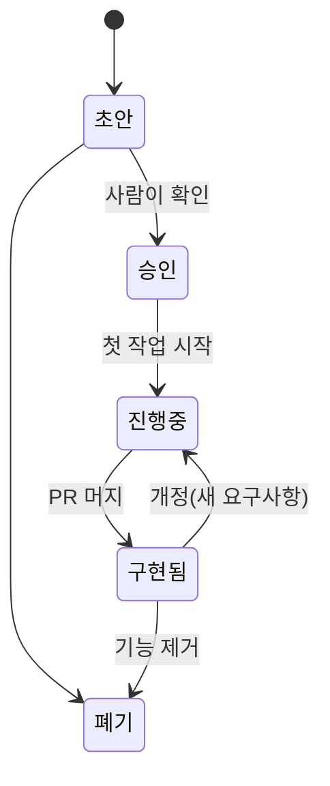

# 05. SDD 개발 프로세스

VoxPrism은 **스펙 주도 개발(SDD, Spec-Driven Development)**로 만듭니다. 사람이든 AI 에이전트든 같은 규칙을 따릅니다.
에이전트가 지킬 규칙의 원문은 [AGENTS.md](../AGENTS.md), 커밋·PR 형식은 [CONTRIBUTING.md](../CONTRIBUTING.md)에 있습니다.

## 1. 원칙

1. **스펙이 기준이다.** 코드는 스펙을 구현한 결과입니다. 스펙과 코드가 다르면 코드를 스펙에 맞추거나, 스펙을 **먼저** 고칩니다. 코드만 고치지 않습니다.
2. **쓰는 순서는 무엇 → 어떻게 → 할 일 → 코드.** `spec.md` → `plan.md` → `tasks.md` → 구현.
3. **사람이 승인한다.** `spec.md`가 `승인` 상태가 되기 전에는 구현 코드를 쓰지 않습니다.
4. **모든 것은 ID로 이어진다.** 요구사항 `FR-…`/`NFR-…` ↔ 스펙 `SPEC-…` ↔ 작업 `T-…` ↔ 커밋 `Refs:` ↔ PR ↔ 테스트.
5. **기준선을 최신으로.** 머지할 때 [01 요구사항](01-요구사항-분석.md)·[02 상세설계](02-상세설계.md)·[03 기능 구현](03-기능-구현.md)·[04 디자인](04-디자인.md) 중 영향받는 절을 같은 PR에서 고칩니다.

## 2. 흐름


| 단계 | 산출물 | 끝났다는 기준 | Claude Code 명령 |
| --- | --- | --- | --- |
| 1 스펙 | `specs/NNN-이름/spec.md` | 문제·범위·요구사항 ID·수용 기준이 있고, 모르는 점은 `[확인 필요]`로 표시. 사람이 `승인` | `/sdd-spec <설명>` |
| 2 설계 | `plan.md` | 바뀌는 모듈·데이터·API, 대안과 선택 이유, 테스트·평가 계획, 위험 | `/sdd-plan SPEC-NNN` |
| 3 작업 | `tasks.md` | 작업마다 요구사항 ID·파일·확인 방법. 한 작업은 커밋 1~3개 크기 | `/sdd-tasks SPEC-NNN` |
| 4 구현 | 코드 + 테스트 | 작업 순서대로, 테스트 먼저, `pytest` 통과, 작업 체크 | `/sdd-implement SPEC-NNN [T-NN]` |
| 5 커밋 | 커밋 | 규칙 형식 + `Refs: SPEC-NNN, T-NN` | `/sdd-commit` |
| 6 PR | PR | 템플릿 채움, CI 녹색, 기준선 문서 갱신 | `/sdd-pr` |
| 7 인계 | `docs/06-인수인계.md` | 다음 사람이 바로 이어서 할 수 있음 | `/sdd-handoff` |

## 3. 스펙이 필요한 변경

| 변경 | 스펙 | 커밋 `Refs:` |
| --- | --- | --- |
| 새 기능, 동작이 바뀌는 수정, 성능 변경 (`feat`, `perf`) | **필수** — 새 스펙 또는 기존 스펙 개정(같은 PR) | 필수 |
| 스펙대로 동작하지 않는 버그 (`fix`) | 기존 스펙을 가리킴, 회귀 테스트 추가 | 필수 |
| 동작이 같은 구조 개선 (`refactor`) | 관련 스펙을 가리키면 좋음, `plan.md` 불필요 | 권장 |
| 문서·CI·빌드·잡무 (`docs`, `ci`, `build`, `chore`, `test`, `style`) | 불필요 | 선택 |
| 스펙 문서 자체 (`spec`) | 그 스펙 | 필수 |

**CI가 지키는 것:** PR이 `app/whosaid/`, `app/deploy/`, `infra/`를 바꾸면 PR 본문에 `SPEC-NNN`이 있어야 하고, 그 스펙 폴더가 있어야 합니다(`.github/workflows/pr-hygiene.yml`). 스펙 폴더 구조와 요구사항 ID는 `scripts/check_specs.py`가 검사합니다.

## 4. 스펙 폴더

```text
specs/
├─ README.md                 스펙 목록과 상태
├─ _templates/               spec.md · plan.md · tasks.md 틀
└─ 003-overlap-recovery/
   ├─ spec.md                무엇·왜 (사용자 관점, 구현 방법 없음)
   ├─ plan.md                어떻게 (설계, 대안, 테스트 계획)
   └─ tasks.md               할 일 (체크리스트)
```

- 번호는 3자리, 이름은 영어 소문자-하이픈. 새 스펙은 `python3 scripts/new_spec.py <이름> "<제목>"`이 다음 번호로 만듭니다.
- 각 파일 맨 위 YAML 머리말을 CI가 읽습니다.

```yaml
---
id: SPEC-003
title: 겹친 말 복원
status: 구현됨          # 초안 | 승인 | 진행 중 | 구현됨 | 폐기
owner: "@Movinggun-bit"
requirements: [FR-OVL-01, FR-OVL-02, NFR-QUAL-01]
updated: 2026-11-18
---
```

### 4.1 상태



`진행 중`은 머리말에 `진행 중`으로 씁니다(띄어쓰기 포함). 구현된 스펙을 고칠 때는 머리말을 `진행 중`으로 바꾸고 본문 맨 아래 **개정 이력**에 한 줄을 더합니다.

### 4.2 작업 형식 (`tasks.md`)

```markdown
- [ ] T-03 배치 재인식 결과를 구간별로 되돌린다 (FR-OVL-03)
  - 파일: app/whosaid/pipeline/overlap.py (map_back)
  - 확인: tests/test_logic.py::test_batch_map_back
```

## 5. 요구사항 ID 규칙

[01 요구사항 분석 1절](01-요구사항-분석.md#1-id-규칙)을 따릅니다. 새 요구사항은 스펙을 쓰면서 01 문서에 **먼저** 추가하고, 번호는 영역마다 이어 붙입니다(지우거나 재사용하지 않음).

## 6. 품질 게이트

| 게이트 | 언제 | 기준 |
| --- | --- | --- |
| 단위 테스트 | 모든 PR | `cd app && python -m pytest -q tests` 통과 (CI `test`) |
| 스펙 검사 | 모든 PR | `python3 scripts/check_specs.py` 통과 (CI `test`) |
| 커밋·PR 위생 | 모든 PR | 형식, 스펙 연결, 자동 생성 서명 없음 (CI `pr-hygiene`) |
| 품질 기준선 | 파이프라인(SPEC-002·003)을 바꾸는 PR | 합성 평가셋 v2에서 cpCER ≤ 0.40, 겹친 발화 재현율 ≥ 0.70. 결과 표를 PR에 첨부 (NFR-QUAL-01) |
| 화면 확인 | UI를 바꾸는 PR | 스크린샷 + [접근성 점검표](04-디자인.md#5-접근성-점검표) |
| 배포 확인 | `app/deploy/`, `infra/`를 바꾸는 PR | `./infra/deploy.sh code` 후 `/api/health` 확인 결과 첨부 |

## 7. 예시: 소리 자막 켜기

1. `/sdd-spec CLOVA 이벤트 탐지를 켜서 웃음·음악 자막 확인` → `specs/008-sound-captions/spec.md` (초안, `FR-CAP-07` 개정)
2. 사람이 범위를 확인하고 "승인" → 머리말 `status: 승인`
3. `/sdd-plan SPEC-008` → 콘솔 설정 절차, 라벨 매핑 점검, 평가 방법
4. `/sdd-tasks SPEC-008` → T-01 콘솔 설정, T-02 라벨 매핑 테스트, T-03 실제 클립 확인
5. `/sdd-implement SPEC-008` → 작업마다 커밋 `feat(captions): 소리 자막 라벨 매핑 보강` + `Refs: SPEC-008, T-02`
6. `/sdd-pr` → CI 녹색 → 머지 → `03 기능 구현` 1절의 FR-CAP-07을 ✅로, 스펙 `구현됨`
