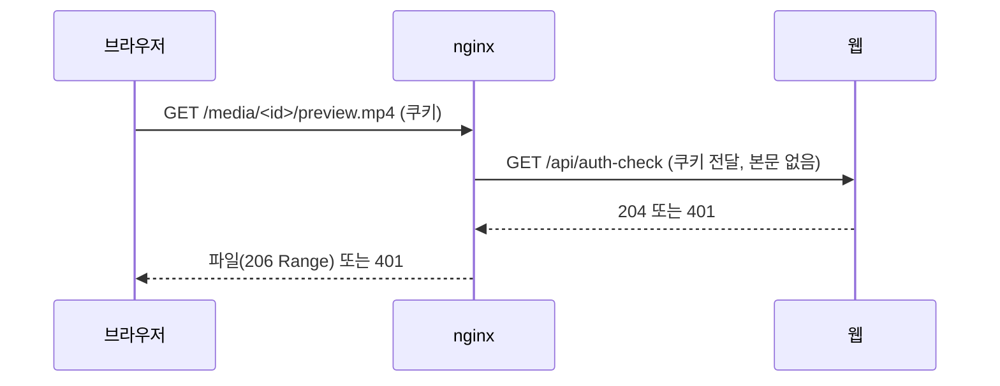

# SPEC-005 설계

## 1. 접근

앱(FastAPI) 미들웨어가 모든 요청의 인증을 판단하고, nginx는 `/media/`를 보낼 때 `auth_request /_auth`로 앱에 물어봅니다. 그래서 큰 영상 파일은 nginx가 Range 요청까지 처리하며 직접 보내고, 인증 규칙은 한 곳(앱)에만 있습니다.

- 세션 토큰: `<만료 epoch>.<HMAC-SHA256(SECRET, 만료)[:40]>`. 서버에 세션 저장소 없음.
- 비교는 모두 `hmac.compare_digest`. 로그인 실패 시 `asyncio.sleep(1.0)`.
- `next`는 `/`로 시작하고 `//`가 아닐 때만 따름.

## 2. 바뀌는 곳

| 영역 | 파일·함수 |
| --- | --- |
| 앱 | `web/main.py` `require_login`, `authed`, `_sign`, `_session_ok`, `_basic_ok`, `login`, `logout`, `auth_check`, `_safe_next` |
| 화면 | `web/static/login.html` |
| nginx | `deploy/nginx-whosaid.conf` (`location = /_auth`, `location ~ ^/media/…`, `location /media/ { return 404; }`) |
| 배포 | `infra/deploy.sh` (비밀번호·세션 키 생성 → `/etc/whosaid.env`) |

## 3. 대안

| 대안 | 결정 | 이유 |
| --- | --- | --- |
| nginx Basic 인증 | 폐기 | 일부 브라우저에서 401, 로그아웃 불가 |
| 앱이 영상도 직접 전송 | 개발용으로만 | Range·성능은 nginx가 낫다 |
| 서버 세션 저장소 | 안 함 | 서명 쿠키로 충분 |

## 4. 테스트

- `tests/test_web.py::test_login_required` — 미로그인 401/303, auth-check 204/401, 틀린 비밀번호, 오픈 리다이렉트 차단, 쿠키·Basic 접근.
- 로그아웃은 자동 테스트가 없음(수동 확인). 다음에 이 스펙을 고칠 때 테스트를 더합니다.
